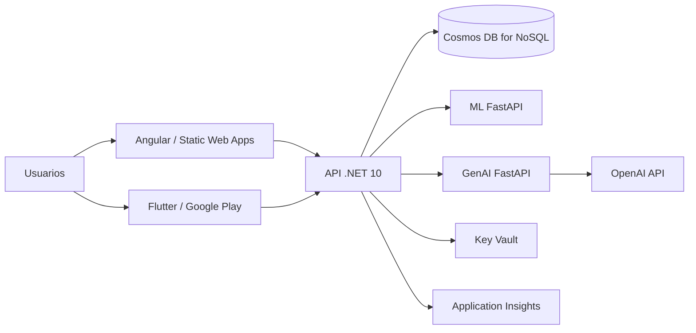

# Arquitectura final de despliegue — BusTrack ML

> **Estado:** propuesta. No hay suscripción, grupo de recursos ni despliegue verificado.
> Esta documentación está separada de las specs funcionales.

## 1. Rol en BusTrack

Container Apps o App Service Linux con contenedor FastAPI; solo la API lo invoca. Key Vault y Application Insights.

## 2. Topología objetivo

## 3. Recursos y responsabilidad

| Recurso | Responsabilidad | Estado |
|---|---|---|
| API .NET 10 | Contratos REST, auth, dominio, acceso a Cosmos. | Propuesto |
| Cosmos DB for NoSQL | Persistencia autorizada; solo la API accede. | Propuesto (hoy SQL Server/EF Core) |
| Key Vault | Secretos y cadenas de conexión. | Propuesto |
| Application Insights | Telemetría y alertas. | Propuesto |
| ML FastAPI | Inferencia interna. | Propuesto (sin código) |
| GenAI FastAPI | Recomendaciones con grounding. | Propuesto (sin código) |
| Static Web Apps | Landing Angular. | Propuesto (hoy Razor) |
| Google Play | Distribución móvil. | Propuesto (sin publicar) |

## 4. Configuración y secretos

- Variables por entorno; sin valores reales en el repositorio.
- Secretos en Key Vault o GitHub Secrets; nunca en el cliente.
- Identidad administrada para API→Key Vault, API→Cosmos y API→ML/GenAI.

## 5. Operación

- Monitoreo con Application Insights y health checks.
- Escalado según carga; límites de tasa en la API.
- Costos estimados pendientes de medición real.

## 6. Diferencias con el estado actual

- Persistencia actual: SQL Server + EF Core (API). Objetivo: Cosmos DB.
- Clientes actuales: Kotlin (mobile) y Razor (landing). Objetivo: Flutter y Angular.
- ML y GenAI: esqueletos sin código.
- Sin Dockerfile ni workflows de despliegue en ML/GenAI.

## 7. Referencias

- Tareas: `../specs/`.
- Endpoints: `../specs-endpoints/`.
- CI/CD: `../cicd/`.
- Contratos: `../docs/contratos-integracion.md`.
