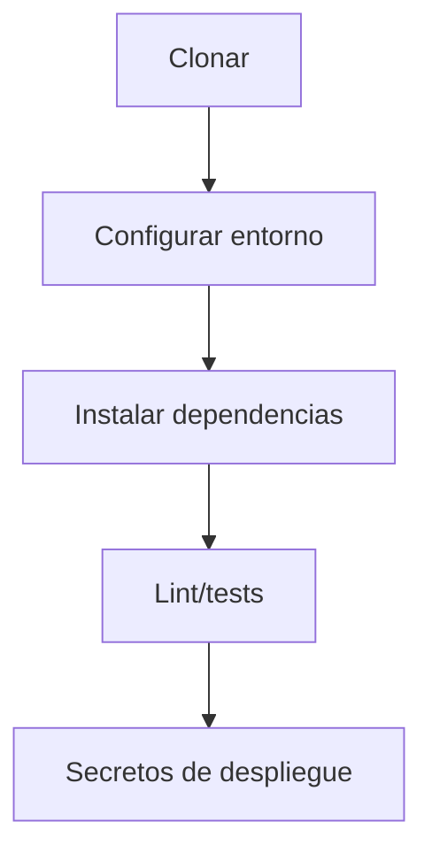
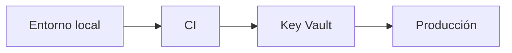
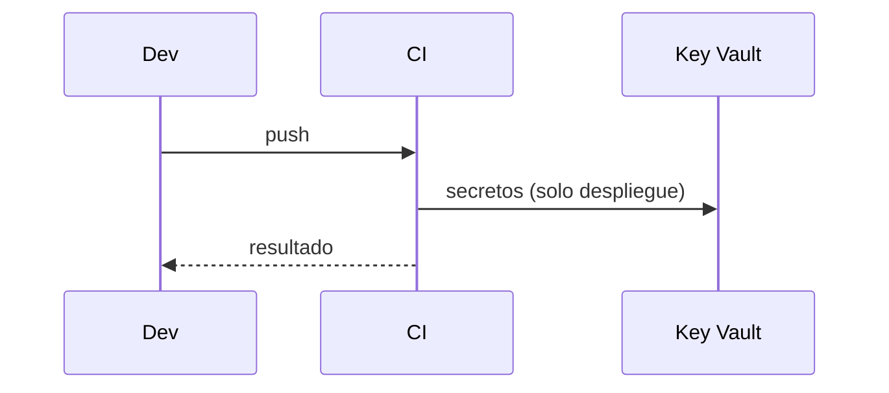

# Diagramas — 01 — Configuración del entorno

> Spec: `spec.md` · Plan: `plan.md`. Diagramas Mermaid; no representan recursos desplegados.

## 1. Flujo funcional

## 2. Relación entre componentes

## 3. Flujo de datos / secuencia

## 4. Notas

Diagramas de proceso; no representan recursos desplegados.
