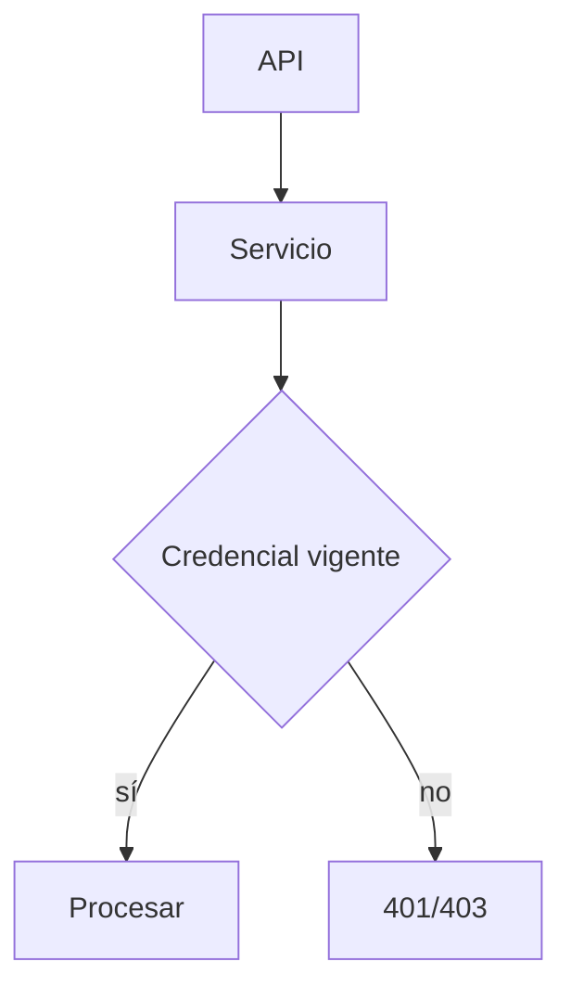
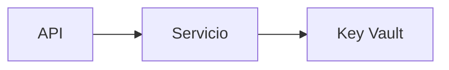
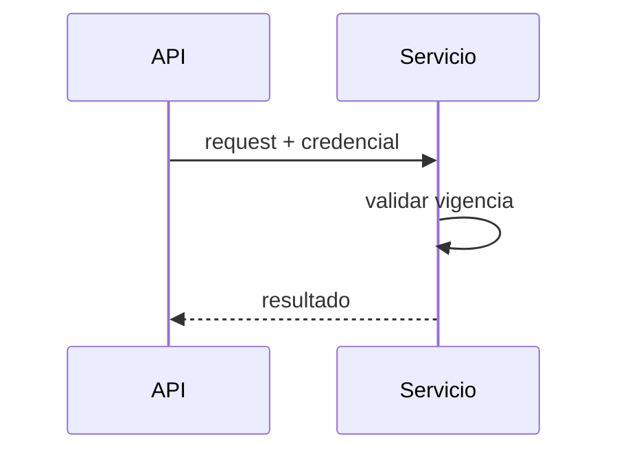

# Diagramas — Cierre de sesión / revocación interna

> Spec: `spec.md` · Plan: `plan.md`. Diagramas Mermaid; no representan recursos desplegados.

## 1. Flujo funcional

## 2. Relación entre componentes

## 3. Flujo de datos / secuencia

## 4. Notas

No aplica sesión de usuario; se documenta la credencial de servicio.
